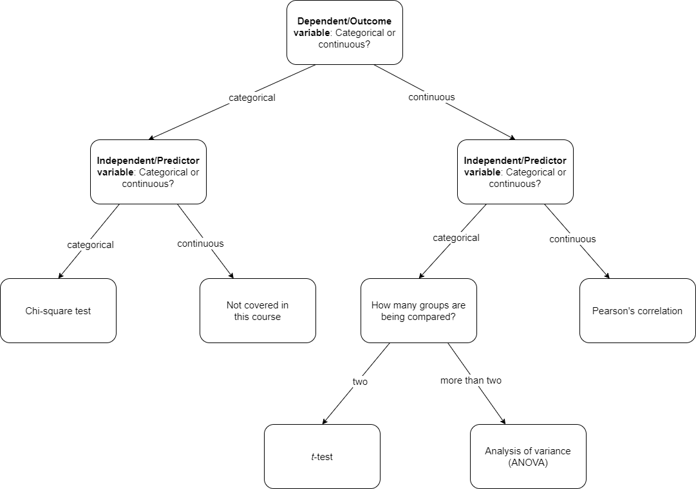

```{r}
#| label: setup
#| include: false
#| message: false
#| warning: false

library(tidyverse)
library(summarytools)
library(rstatix)
library(kableExtra)
library(formatR)

# Read data into R
covid <- read_csv(here::here("COMM-3710", "LA","covid.csv"))

```

# Learning Outcomes

In this assignment, you will:

- Identify the independent and dependent variables in a research question.
- Select the appropriate statistical test.
- Conduct a statistical test.
- Interpret the results of a statistical test.
- Practice recoding variables with `mutate()` and `case_when()` (LA-5 and LA-6).

::: callout-tip
Read all the instructions carefully before starting the assignment. Set up your R script as you did in LA-4 to LA-6 (name, uNID, date, assignment number).
:::

::: callout-important
**How to report your answers.** Write each answer as a comment in your R script, labeled with its question number (e.g., `# 3a: ...`). Report test results in APA format, as shown in the section "Conducting a Statistical Test in R" at the end of this document. Round means and standard deviations to two decimal places.
:::

::: callout-note
**Key ideas for this assignment** (from lecture and Wrench Ch. 15 to 18):

- The **independent variable (IV)** is the variable we think *explains* or *predicts* differences. The **dependent variable (DV)** is the outcome we are measuring (i.e., the dependent variable *depends* on the independent variable).
- A **categorical** variable sorts cases into groups (e.g., region). A **continuous** variable is a number that can take many values (e.g., number of contacts).
- Every statistical test gives a **test statistic** (e.g., *F*, *t*) and a **probability value** (*p*-value). In this course, if *p* < .05, we conclude that there **is** a statistically significant difference (or relationship). If *p* $\ge$ .05, we conclude that we **do not** have evidence of a difference (or relationship).
:::

------------------------------------------------------------------------

# Instructions

1) Load the packages below. Then download the `covid.csv` dataset and its codebook from Canvas, upload the dataset to your Posit Cloud project (as you did in LA-4 to LA-6), and read it into R. Use the codebook to familiarize yourself with the data in this file.
   
   * `tidyverse`
   * `summarytools`
   * `rstatix` (you installed this in LA-3; if R says it can't find the package, run `install.packages("rstatix")` first)

::: callout-note
**About this dataset.** Each row (case) is **one country on one survey date** during the COVID-19 pandemic. The values are **averages** of the people surveyed in that country on that date. For example, `total_contacts` is the average number of contacts people in that country had on the previous day. There are 14 countries, each surveyed on several dates.
:::
   
2) Create a new variable called `region`. Have the variable equal `Americas` if the country is Brazil, Canada, Mexico, or the United States. Have the variable equal `Asia` if the country is China, India, Japan, Singapore, or South Korea. Have the variable equal `Europe` if the country is Denmark, France, Germany, Italy, or Spain. Run a frequency distribution of `region`. Which region has the highest frequency?

::: callout-tip
Use `mutate()`, `case_when()`, and `|` ("or") the same way you created `season` in LA-6. Country names must be spelled exactly as they appear in the data (e.g., `"United States"`, `"South Korea"`); run `freq(country)` to check. Remember to save the result back to `covid` (start with `covid <- covid |> ...`), because you will use `region` in Questions 3 and 4.
:::

```{r}
#| label: ans2
#| include: false
#| eval: false

covid |> freq(country)

covid <- covid |> 
        mutate(region = case_when(
                country == "Brazil" | country == "Canada" | country == "Mexico" | country == "United States" ~ "Americas",
                country == "China" | country == "India" | country == "Japan" | country == "Singapore" | country == "South Korea" ~ "Asia",
                country == "Denmark" | country == "France" | country == "Germany" | country == "Italy" | country == "Spain" ~ "Europe",
                        ))

covid |> freq(region)

#2: Europe.

```

3) Let’s say we want to conduct a statistical test to determine whether the average total number of contacts people had on the previous day differs by region. First, answer the questions below. Be sure to include your answers as comments in your R file.

   a) Which variables are involved in this statistical test? Which is the independent variable? Which is the dependent variable?
   b) Run a frequency distribution of `total_contacts`. Is this variable categorical or continuous? (The frequency table will be long. That's expected, and it is a clue to your answer.)
   c) Is the variable `region` continuous or categorical?
   d) Given your answers to the previous questions, what statistical test should you use? Why? Use the flowchart in the section "Selecting a Statistical Test" at the end of this document. Start at the top with the DV.
   
```{r}
#| label: ans3
#| include: false
#| eval: false

#3a: `total_contacts` and `region`. IV = `region`, DV = `total_contacts`.

covid |> freq(total_contacts)

#3b: `total_contacts` is a continuous variable.
#3c: `region` is a categorical variable.
#3d: Analysis of variance (ANOVA).

```

4) Conduct the statistical test from your answer to 3d. Answer the following questions.

   a) What is the test statistic and the probability value (i.e., *p*-value) associated with that test statistic? Report them in APA format.
   b) Based on the test statistic and the *p*-value, does the average total number of contacts differ by region? (See the *p* < .05 rule in "Key ideas" above.)
   
```{r}
#| label: ans4
#| include: false
#| eval: false

covid |> 
        anova_test(total_contacts ~ region)

#4a: F(2, 157) = 7.51, p < .001
#4b: Yes, the average total number of contacts differs by region (p < .05).
# (Means: Americas 10.61, Asia 14.64, Europe 12.18; not required.)

```

5) Next, let's compare how mask-wearing differs between the first and second year after the COVID outbreak. Follow the steps below to select and conduct the appropriate statistical test.

   a) State your hypothesis. Do you think people wore masks outside more often in the first or second year after the outbreak? Why? There is no wrong answer here; you will test your hypothesis in the steps below.
   b) Identify the dependent variable. Is it continuous or categorical?
   c) Which existing variable in the dataset can you use to create the independent variable? Create a new variable called `yr_after_outbreak` using the `mutate()` and `case_when()` functions. Have it equal `first year` if the survey was taken 365 days or fewer after the outbreak, and `second year` if it was taken more than 365 days after the outbreak. Run `freq()` on your new variable to check it. Is this new variable continuous or categorical?
   d) Select and conduct the appropriate statistical test. Use the flowchart, as in #3d.
   e) Report the test statistic and probability value in APA format as a comment in your R script.
   f) Calculate the means and standard deviations of the dependent variable for the first and second years after the COVID outbreak. Include these descriptive statistics in your R script. Did people wear masks more often when they went outside in the first or second year after the outbreak?
   g) Based on the *p*-value and your answer to 5f, does the statistical test support your hypothesis from 5a? Explain.

::: callout-tip
**For 5c:** Use the same template as `Project.Size` in LA-5, with `<=` and `>`. Remember to save the result back to `covid`.

**For 5f:** Add `group_by()` before `descr()` to get statistics for each group in one step:

```
covid |>
  group_by(yr_after_outbreak) |>
  descr(masks_outside)
```

(Alternatively, `filter()` for `first year` and run `descr(masks_outside)`, then repeat for `second year`.)

**About the sign of *t*:** `t_test()` subtracts the mean of the second group from the mean of the first group (groups are in alphabetical order). A **negative** *t* means the first group's mean is **lower**; it does not mean you made a mistake. Use the means from 5f to see which group is higher.
:::
   
```{r}
#| label: ans5
#| include: false
#| eval: false

#5a: People wore masks more often in the first year after the outbreak compared to the second year after the outbreak.
# (Any hypothesis is acceptable if it gives a reason; grade 5g on consistency with the student's 5a.)
#5b: DV = `masks_outside`
#5c: We can use `days_since_outbreak` to create the independent variable.

covid <- covid |> 
        mutate(yr_after_outbreak = case_when(
                days_since_outbreak <= 365 ~ "first year",
                days_since_outbreak > 365 ~ "second year"
        ))

covid |> freq(yr_after_outbreak)

#5d: t-test

covid |> 
        t_test(masks_outside ~ yr_after_outbreak)

#5e: t(157) = -3.80, p < .001 (accept t(156.83); t_test() uses Welch's test, so df is not a whole number)
#5f: The mean of mask wearing is higher in the second year after the outbreak compared to the first.

covid |> 
        group_by(yr_after_outbreak) |> 
        descr(masks_outside)

# First year: M = 82.56, SD = 22.31
# Second year: M = 91.27, SD = 6.63

#5g: The difference is significant (p < .05), but masks were worn MORE in the second year,
# so the test does not support the hypothesis posed in #5a.
# (A student who predicted the second year would answer "supported.")

```
   
------------------------------------------------------------------------

# Submission

Submit your R script (named `LA-#_FirstName-LastName.R`) to Canvas.

Your R script should:

1)  Include commands and functions that are necessary to address all the questions in the assignment.
2)  Contain comments that answer the questions in the assignment.
3)  Run in its entirety without errors.

To ensure that your R script runs without errors, you should:

-   Save your script.
-   Navigate back to Your Workspace on Posit Cloud.
-   Reopen your project.
-   Run the entire script line-by-line without editing it to ensure there are no errors.

::: callout-important
These standards apply to all submissions in this course that require R scripts. You should follow these instructions for preparation, naming, and saving of your R script for all of your individual lab assignments.
:::

\newpage

# Selecting a Statistical Test



# Conducting a Statistical Test in R

The example output below is **made up** for illustration, so your numbers will be different. Use these examples to see what the output looks like and how to report it.

## Chi-squared test

A chi-squared test is used when we want to compare two categorical variables. To do so in R, you can use the following command (`df`, `dep_var`, and `ind_var` have to be replaced with the names of your dataframe, dependent variable, and independent variable, respectively). The output that results from running this command in R is shown below as comments.

```{r}
#| label: chisq
#| eval: false
#| include: true

chisq_test(x = df$ind_var, y = df$dep_var)

# A tibble: 1 × 6
#       n statistic         p    df method          p.signif
# * <int>     <dbl>     <dbl> <int> <chr>           <chr>   
# 1   200      6.84    0.0327     2 Chi-square test *   

```

To report the results of your chi-squared test in APA format, you would use the following format, replacing the text in bold font with the results from your Console:

> $\chi^2$(**`df`**, $N$ = **`n`**) = **`statistic`**, *p* = **`p`**

From the results of the above chi-squared test, I would report results like this: $\chi^2(df = 2, N = 200) = 6.84$, $p = .033$. If the *p*-value is less than .001, you do not need to report the exact value. If it is greater than .001, then report the exact value rounded to two or three decimal places.

## *t*-test

A *t*-test is used to compare the mean values of a continuous variable between two groups. To do so in R, you can use the following command (`df`, `dep_var`, and `ind_var` have to be replaced with the names of your dataframe, dependent variable, and independent variable, respectively). The output that results from running this command in R is shown below as comments.

```{r}
#| label: t-test
#| eval: false
#| include: true

df |> 
        t_test(dep_var ~ ind_var)

# A tibble: 1 × 10
#   .y.        group1 group2    n1    n2 statistic    df        p    p.adj p.adj.signif
# * <chr>      <chr>  <chr>  <int> <int>     <dbl> <dbl>    <dbl>    <dbl> <chr>       
# 1 dep_var ind_var1  ind_var2  48    52     -4.12  97.6 7.94e-05 7.94e-05 ****   
          
```

To report the results of your *t*-test in APA format, you would use the following format, replacing the text in bold font with the results from your Console:

> $t$(**`df`**) = **`statistic`**, *p* = **`p`**

Using the results above, I would report the results of a *t*-test like this: $t(df = 98) = -4.12$, $p < .001$. Round `df` to a whole number if it has decimals.

## Analysis of variance (ANOVA)

ANOVA is used when we want to compare the mean values of continuous variable between more than two groups. To do so in R, you can use the following command (`df`, `dep_var`, and `ind_var` have to be replaced with the names of your dataframe, dependent variable, and independent variable, respectively). The output that results from running this command in R is shown below as comments.

```{r}
#| label: aov
#| eval: false
#| include: true

df |> 
        anova_test(dep_var ~ ind_var)

# ANOVA Table (type II tests)
#
#   Effect  DFn DFd     F        p p<.05   ges
# 1 ind_var   2 450 8.936 0.000156     * 0.038

```

To report the results in APA format:

> $F$ (`DFn`, `DFd`) = `F-value`, $p =$ `p-value`

Using the results above, I would report: $F(2, 450) = 8.94$, $p < .001$.

## Correlation

We use Pearson's correlation to examine a linear relationship between two continuous variables. To run a correlation in R, you can use the following command (`df`, `dep_var`, and `ind_var` have to be replaced with the names of your dataframe, dependent variable, and independent variable, respectively). The output that results from running this command in R is shown below as comments.

```{r}
#| label: cor
#| eval: false
#| include: true

df |> 
        cor_test(dep_var, ind_var)

# # A tibble: 1 × 8
#   var1          var2                  cor statistic        p conf.low conf.high method 
#   <chr>         <chr>               <dbl>     <dbl>    <dbl>    <dbl>     <dbl> <chr>  
# 1 dep_var       ind_var              0.31      4.59 0.00000793   0.178     0.431 Pearson

```

To report the results in APA format:

> Pearson's $r$ = `cor`, $p =$ `p-value` (or $p < .001$ if the *p*-value from your test is very small, i.e., less than .001)

Using the results above, I would report: Pearson's $r = 0.31$, $p < .001$.